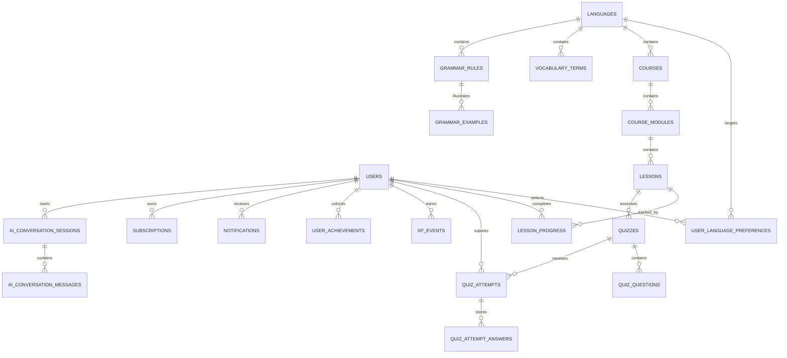

# Database Documentation

## Database

Fluento uses PostgreSQL as the primary database. Flyway migrations under `backend/fluento-api/src/main/resources/db/migration` are the source of truth for schema changes.

## Implemented Schema

### `users`

Implemented in `V1__create_users_table.sql`.

Columns:

- `id`: UUID primary key.
- `first_name`: required user first name.
- `last_name`: required user last name.
- `email`: required unique email.
- `password_hash`: BCrypt password hash.
- `role`: `USER` or `ADMIN`.
- `enabled`: account enabled flag.
- `email_verified`: email verification flag.
- `created_at`: creation timestamp.
- `updated_at`: update timestamp.
- `deleted_at`: soft-delete timestamp.

Indexes:

- `pk_users` on `id`.
- `uk_users_email` on `email`.
- `idx_users_deleted_at` on `deleted_at`.

### `refresh_tokens`

Implemented in `V2__create_refresh_tokens_table.sql`.

Columns:

- `id`: UUID primary key.
- `user_id`: owning user.
- `token_hash`: SHA-256 hash of the raw refresh token.
- `expires_at`: expiration timestamp.
- `revoked_at`: revocation timestamp.
- `created_at`: creation timestamp.
- `updated_at`: update timestamp.
- `deleted_at`: soft-delete timestamp.

Indexes:

- Unique index/constraint on `token_hash`.
- Index on `user_id`.
- Index on `expires_at`.
- Index on `revoked_at`.

### `email_verification_tokens`

Implemented in `V15__create_auth_recovery_tables.sql`.

Stores hashed one-time email verification tokens with expiration and used timestamp.

### `password_reset_tokens`

Implemented in `V15__create_auth_recovery_tables.sql`.

Stores hashed one-time password reset tokens with expiration and used timestamp.

### `user_profiles`

Implemented in `V9__create_user_profiles_table.sql`.

Stores optional learner profile preferences separate from authentication identity, including avatar URL, native language code, target learning language codes, learning level, and daily goal minutes.

### `languages`

Implemented in `V3__create_learning_catalog_tables.sql`.

Stores enabled language catalog entries such as German, Spanish, and French.

### `courses`

Implemented in `V3__create_learning_catalog_tables.sql`.

Stores language-specific learning paths with title, slug, description, level, status, and display position.

### `course_modules`

Implemented in `V3__create_learning_catalog_tables.sql`.

Stores ordered modules belonging to a course.

### `lessons`

Implemented in `V4__create_lessons_table.sql`.

Stores published and draft lesson content under course modules. Current fields include module, title, description, lesson type, status, content, estimated minutes, and display position.

### `vocabulary_terms`

Implemented in `V5__create_vocabulary_tables.sql`.

Stores enabled vocabulary terms by language with translation, pronunciation, example, and tags.

### `user_vocabulary`

Implemented in `V17__create_user_vocabulary_table.sql`.

Stores learner vocabulary state by user and term, including favorites, mastery level, and latest review timestamp.

### `grammar_rules`

Implemented in `V6__create_grammar_tables.sql`.

Stores enabled grammar rules by language with title, slug, explanation, learning level, and display position.

### `grammar_examples`

Implemented in `V6__create_grammar_tables.sql`.

Stores ordered examples for grammar rules, including source text, translation, and optional explanatory note.

### `quizzes`

Implemented in `V7__create_quiz_tables.sql`.

Stores published and draft lesson quizzes with title, description, status, passing score, and display position.

### `quiz_questions`

Implemented in `V7__create_quiz_tables.sql`.

Stores ordered quiz questions with type, prompt, options JSON, correct answer, explanation, and point value. Correct answers are persisted for future scoring but are not returned by public catalog responses.

### `lesson_progress`

Implemented in `V8__create_progress_tables.sql`.

Stores one progress row per user and lesson with completion state, completion timestamp, optional score, and awarded XP. A unique constraint on `user_id` and `lesson_id` prevents duplicate lesson completion records.

### `xp_events`

Implemented in `V8__create_progress_tables.sql`.

Stores auditable XP events such as lesson completion, future quiz pass events, daily goal events, and achievement unlock events.

### `quiz_attempts`

Implemented in `V10__create_quiz_attempt_tables.sql`.

Stores scored quiz submissions by user and quiz, including raw score, max score, percentage, pass/fail state, and XP earned.

### `quiz_attempt_answers`

Implemented in `V10__create_quiz_attempt_tables.sql`.

Stores submitted answers per question with correctness and awarded points for auditability and future analytics.

### `notifications`

Implemented in `V11__create_notifications_table.sql`.

Stores user notifications with type, title, message, optional action URL, and read timestamp.

### `achievements`

Implemented in `V12__create_achievement_tables.sql`.

Stores enabled achievement definitions such as first lesson, five lessons, first quiz pass, and 100 XP.

### `user_achievements`

Implemented in `V12__create_achievement_tables.sql`.

Stores achievement unlocks per user with a unique user-achievement constraint.

### `user_streaks`

Implemented in `V13__create_user_streaks_table.sql`.

Stores current and longest streak counts plus the latest learning activity date per user.

### `subscription_plans`

Implemented in `V14__create_subscription_tables.sql`.

Stores enabled pricing plans with billing interval, price, currency, premium flag, and display order.

### `user_subscriptions`

Implemented in `V14__create_subscription_tables.sql`.

Stores user subscription state, provider identifiers, current billing period, status, and cancellation flag.

### `payment_events`

Implemented in `V14__create_subscription_tables.sql`.

Stores provider payment events for monitoring, reconciliation, and future webhook processing.

### `ai_conversation_sessions`

Implemented in `V16__create_ai_tutor_tables.sql`.

Stores AI tutor sessions by user and target language.

### `ai_conversation_messages`

Implemented in `V16__create_ai_tutor_tables.sql`.

Stores user, tutor, and system messages with provider/model metadata.

## Planned MVP Tables

- `lesson_sections`
- `vocabulary_examples`
- `grammar_exercises`
- `quiz_answers`
- `daily_goals`
- `admin_audit_logs`

## Design Rules

- Use UUID primary keys for externally referenced domain entities.
- Use Flyway for every schema change; do not rely on Hibernate DDL generation outside tests.
- Use soft delete for user-owned content and administrative records where auditability matters.
- Use unique constraints for business invariants such as language codes, course slugs, and user-email uniqueness.
- Store language content as normalized domain data, not hardcoded enum-only logic.
- Add indexes for foreign keys, slugs, search columns, and high-volume progress/event queries.

## ERD Baseline

