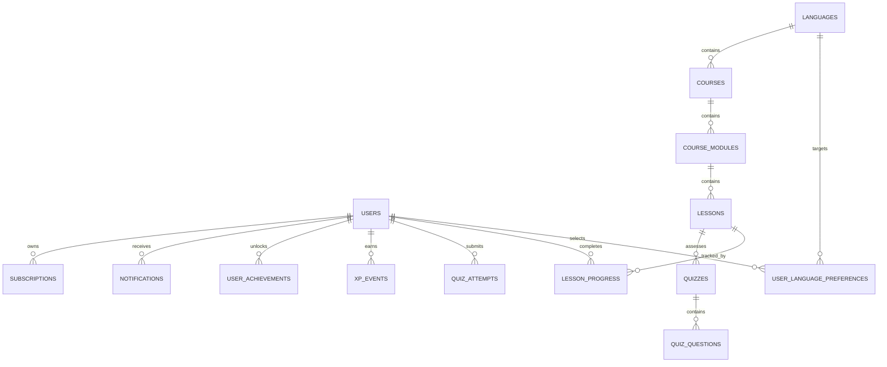

# Database Documentation

## Database

Fluento uses PostgreSQL as the primary database. Flyway migrations under `backend/fluento-api/src/main/resources/db/migration` are the source of truth for schema changes.

## Implemented Schema

### `users`

Implemented in `V1__create_users_table.sql`.

Columns:

- `id`: UUID primary key.
- `first_name`: required user first name.
- `last_name`: required user last name.
- `email`: required unique email.
- `password_hash`: BCrypt password hash.
- `role`: `USER` or `ADMIN`.
- `enabled`: account enabled flag.
- `email_verified`: email verification flag.
- `created_at`: creation timestamp.
- `updated_at`: update timestamp.
- `deleted_at`: soft-delete timestamp.

Indexes:

- `pk_users` on `id`.
- `uk_users_email` on `email`.
- `idx_users_deleted_at` on `deleted_at`.

## Planned MVP Tables

- `refresh_tokens`
- `email_verification_tokens`
- `password_reset_tokens`
- `user_profiles`
- `languages`
- `user_language_preferences`
- `courses`
- `course_modules`
- `lessons`
- `lesson_sections`
- `lesson_progress`
- `vocabulary_terms`
- `vocabulary_examples`
- `user_vocabulary`
- `grammar_rules`
- `grammar_examples`
- `grammar_exercises`
- `quizzes`
- `quiz_questions`
- `quiz_answers`
- `quiz_attempts`
- `quiz_attempt_answers`
- `xp_events`
- `streaks`
- `achievements`
- `user_achievements`
- `daily_goals`
- `notifications`
- `subscriptions`
- `payment_events`
- `admin_audit_logs`

## Design Rules

- Use UUID primary keys for externally referenced domain entities.
- Use Flyway for every schema change; do not rely on Hibernate DDL generation outside tests.
- Use soft delete for user-owned content and administrative records where auditability matters.
- Use unique constraints for business invariants such as language codes, course slugs, and user-email uniqueness.
- Store language content as normalized domain data, not hardcoded enum-only logic.
- Add indexes for foreign keys, slugs, search columns, and high-volume progress/event queries.

## ERD Baseline

